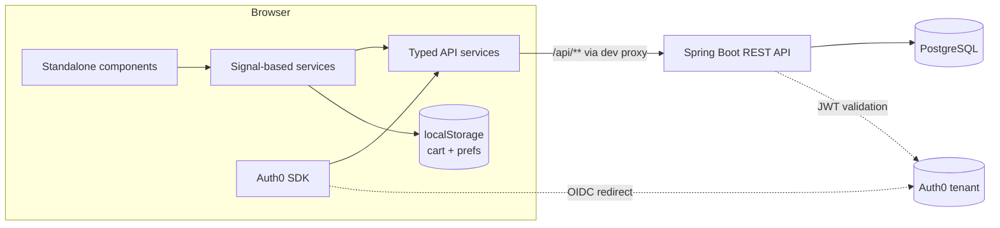

# Shopora — Web

Angular 22 storefront for **Shopora**, a full-stack ecommerce application. It consumes the
[Shopora REST API](https://github.com/ManojGaikwadLearner/shopora-api) (Spring Boot + PostgreSQL)
and handles browsing, cart, authentication and checkout.

Built with the modern Angular stack: standalone components, signals, the new control flow,
typed reactive forms, and **zoneless change detection** (no `zone.js` in the bundle).


---

## Features

- **Product catalogue** — paginated grid with page-size control, backed by Spring Data REST
- **Browse by category** — sidebar navigation with deep-linkable category routes
- **Search** — keyword search with its own route, so results are shareable
- **Product details** — individual product pages
- **Shopping cart** — add, increment, decrement and remove, with totals derived from cart state
- **Cart persistence** — cart survives a page refresh via a validated `localStorage` layer
- **Authentication** — Auth0 OIDC login with redirect flow, guarded routes and bearer tokens
  attached to protected API calls
- **Checkout** — multi-section typed reactive form with cross-field validation, dependent
  country/state dropdowns, and "billing same as shipping" copying
- **Order confirmation** — order tracking number returned by the API

## Tech stack

| Area | Choice |
| --- | --- |
| Framework | Angular 22.2 (standalone, zoneless, OnPush by default) |
| Language | TypeScript 6.0 |
| Reactivity | Signals, `computed`, `effect`, `toSignal` + RxJS where streams are genuinely streams |
| UI | Bootstrap 5.3, ng-bootstrap 21, Font Awesome 7 |
| Auth | Auth0 (`@auth0/auth0-angular`) with the functional HTTP interceptor |
| Testing | Vitest (Angular's default runner since v21) |
| Backend | [shopora-api](https://github.com/ManojGaikwadLearner/shopora-api) — Spring Boot, PostgreSQL |

## Architecture



Notes on the design:

- **Relative API URLs.** Services call `/api/...`, never an absolute host. In development the
  Angular dev-server proxy forwards to the backend; in production a reverse proxy does the same
  job. One code path, no CORS, no per-environment URL branching.
- **Signals for state, RxJS for streams.** Cart totals are `computed` from cart items, so they
  cannot drift. RxJS stays where time and cancellation matter — `switchMap` on route params,
  debounced search.
- **Validated storage boundary.** Anything read back from `localStorage` is `unknown` until a
  type guard proves its shape, so stale or hand-edited data falls back to a safe default
  instead of producing `NaN` totals.

## Getting started

### Prerequisites

- Node.js 20.19+ (or 22.12+)
- npm 11+
- The [Shopora API](https://github.com/ManojGaikwadLearner/shopora-api) running locally on
  `https://localhost:8443`
- An Auth0 tenant (free) with a Single Page Application and an API registered

### 1. Install

```bash
git clone https://github.com/ManojGaikwadLearner/shopora-web.git
cd shopora-web
npm install
```

### 2. Configure Auth0

Update the Auth0 settings in `src/app/common/app-config.ts` with your own tenant values:

```ts
domain:   'your-tenant.us.auth0.com',
clientId: 'your-spa-client-id',
authorizationParams: {
  redirect_uri: window.location.origin,
  audience: 'https://localhost:8443',   // must match the API identifier in Auth0
},
```

In the Auth0 dashboard, add `https://localhost:4200` to **Allowed Callback URLs**,
**Allowed Logout URLs** and **Allowed Web Origins**, and create an API whose identifier matches
the `audience` exactly.

> The domain and client ID are public values in a SPA — they ship in the bundle — so they are
> safe to commit. Never commit a client **secret**.

### 3. Local HTTPS certificate

The dev server runs over HTTPS so the OIDC redirect behaves like production. Generate a
locally trusted certificate into `ssl-localhost/`:

```bash
brew install mkcert && mkcert -install        # macOS; use choco/scoop on Windows
mkcert -key-file ssl-localhost/localhost.key -cert-file ssl-localhost/localhost.crt localhost 127.0.0.1
```

### 4. Run

```bash
npm start
```

Open **https://localhost:4200**. The app reloads on source changes.

## Available scripts

| Command | What it does |
| --- | --- |
| `npm start` | Dev server over HTTPS on port 4200, with the API proxy enabled |
| `npm run build` | Production build into `dist/` |
| `npm run watch` | Development build, rebuilt on change |
| `npm test` | Unit tests with Vitest |

## API proxy

`proxy.conf.json` forwards `/api` to the backend so the browser only ever talks to one origin:

```json
{
  "/api": {
    "target": "https://localhost:8443",
    "secure": false,
    "changeOrigin": true
  }
}
```

`secure: false` accepts the backend's self-signed development certificate. Change `target` if
your API runs elsewhere.

## App Screens


## Project structure

```
src/app/
├── common/              # framework-free shared code
│   ├── app-config.ts        # Auth0 configuration
│   ├── app-paths.ts         # route paths + typed link builders
│   ├── validation.ts        # regex patterns, custom validators, error messages
│   └── address-form.ts      # reusable address FormGroup factory
├── components/          # presentational + layout components
│   ├── header/ side-menu/ footer/
│   ├── search/ cart-status/ login-status/
│   ├── field-row/           # label + control + error, used across all forms
│   ├── address-fieldset/    # shipping and billing reuse one component
│   └── page-layout/
├── features/            # routed pages (all lazy-loaded)
│   ├── product-list/ product-details/
│   ├── cart-details/ checkout/
│   ├── login/ members-page/
├── services/            # API access and state
│   ├── product.service.ts
│   ├── cart.service.ts      # signal store: items + computed totals
│   ├── app-form.service.ts  # countries, states, credit-card data
│   └── models/              # Product, CartItem, Country, State, Order DTOs
├── core/
│   └── browser-storage.service.ts   # typed, SSR-safe, validated localStorage
├── app.config.ts        # providers: router, http, Auth0, interceptors
└── app.routes.ts        # lazy routes with titles and auth guards
```

## Angular 22 features used

A deliberate tour of the current Angular stack, useful as a reference:

| Feature | Where |
| --- | --- |
| Standalone components (no NgModules) | Everywhere |
| Zoneless change detection | No `zone.js` dependency at all |
| Signals, `computed`, `effect` | `cart.service.ts`, `browser-storage` persistence |
| `toSignal()` RxJS interop | `login-status`, auth state |
| Signal inputs / `input.required()` | `field-row`, `address-fieldset`, `product-card` |
| New control flow (`@if` / `@for` / `@empty`) | All templates |
| `inject()` over constructor injection | All services and components |
| `@Service()` decorator | Root-provided services |
| Typed reactive forms + `NonNullableFormBuilder` | `checkout` |
| Functional route guards and HTTP interceptors | `app.routes.ts`, `app.config.ts` |
| Lazy routes via `loadComponent` | `app.routes.ts` |
| Vitest as the test runner | `npm test` |

## Roadmap

- [ ] Order history for signed-in users
- [ ] Product image gallery and zoom
- [ ] Wishlist
- [ ] Unit tests for the cart store and checkout mapper
- [ ] CI workflow (lint, test, build) on GitHub Actions
- [ ] Docker Compose for web + API + PostgreSQL

## Related repositories

- [shopora-api](https://github.com/ManojGaikwadLearner/shopora-api) — Spring Boot REST API

## License

Released under the MIT License.
